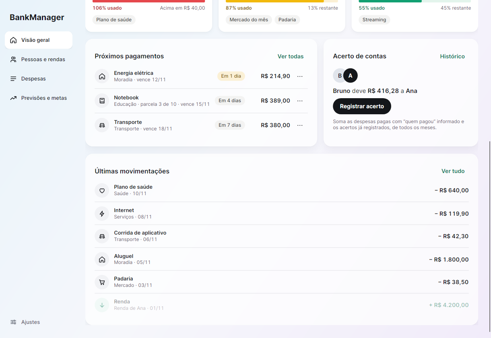
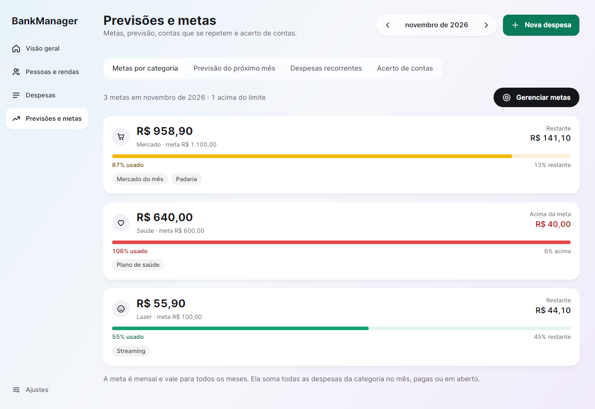
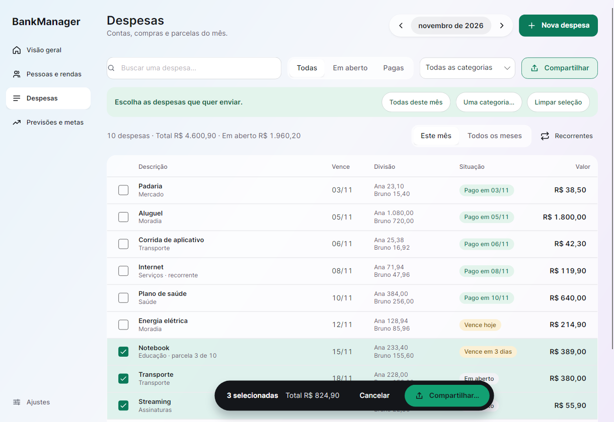
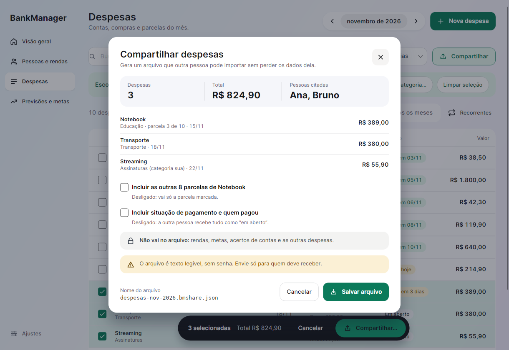
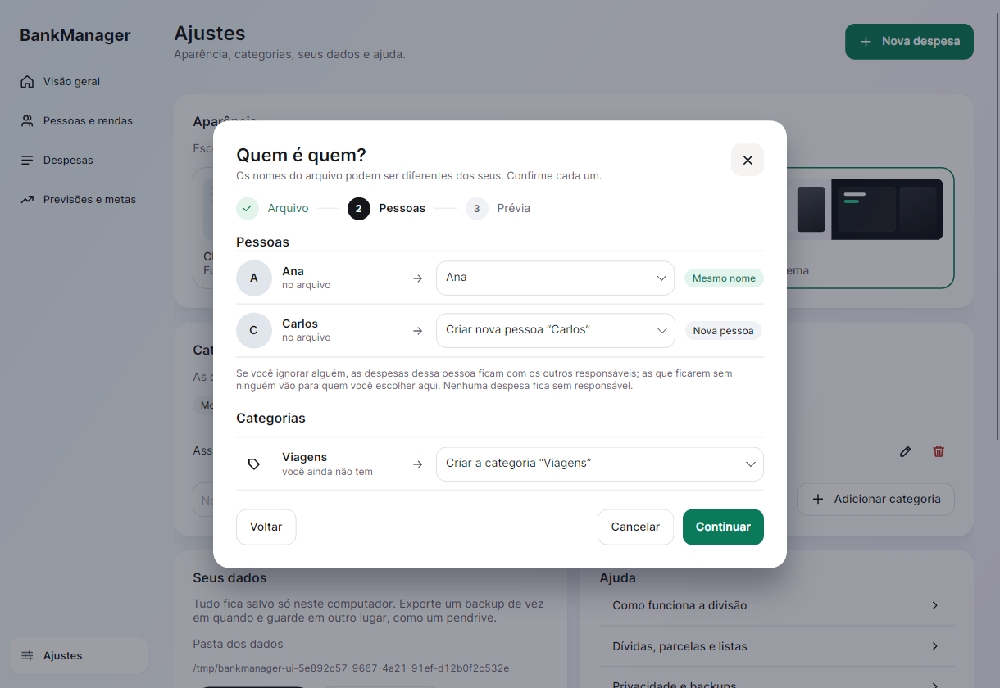
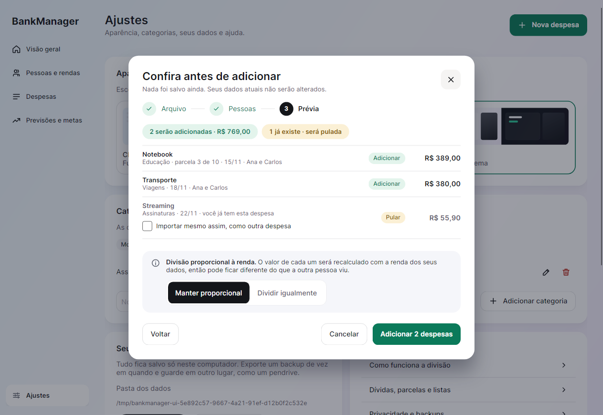

# BankManager

Aplicativo desktop de gestão financeira individual e familiar em **C# / .NET 10 e Avalonia 12.1.4**. Interface em português, arejada e minimalista (verde e tons neutros), com tema claro, escuro ou automático (segue o sistema), menu lateral e armazenamento local. Começa vazio, sem dados fictícios na base do usuário.

**Sobre o desenvolvimento:** este projeto foi desenvolvido com **vibe coding**, usando o Codex para gerar e ajustar o código a partir de instruções em linguagem natural. A proposta, os requisitos e as decisões de produto foram definidos pelo autor do projeto.










## Baixar pronto e compartilhar

**[Baixar a versão mais recente](https://github.com/Muzi3060/BankManager/releases/latest)**

| Computador | Arquivo | Como usar |
| --- | --- | --- |
| Windows 64 bits (Intel/AMD) | `BankManager-2.2.0-win-x64-setup.exe` | **Instalador (recomendado).** Dê dois cliques; instala só para você, sem administrador, com atalho no menu Iniciar |
| Windows 64 bits (Intel/AMD) | `BankManager-2.2.0-win-x64.zip` | Portátil: extrair **tudo** e abrir `BankManager.exe` |
| Linux 64 bits (Intel/AMD) | `BankManager-2.2.0-x86_64.AppImage` | **Um arquivo só (recomendado).** `chmod +x` e dois cliques, ou `./BankManager-2.2.0-x86_64.AppImage` |
| Linux 64 bits (Intel/AMD) | `BankManager-2.2.0-linux-x64.tar.gz` | Portátil: extrair **tudo**, `./Iniciar.sh`; `./Instalar-atalho.sh` cria o atalho e o ícone no menu |

Todos incluem o .NET: não é preciso instalar SDK, Rider ou Visual Studio. Para compartilhar, envie o **link da release** ou o arquivo **completo**. Não envie só o executável, nem seus backups financeiros. Veja [as instruções incluídas no pacote](docs/LEIA-ME.txt).

**Sem assinatura digital.** O Windows pode avisar "editor não identificado"; confira que o download veio deste repositório e, se quiser, o checksum (`.sha256`, mais abaixo). No Linux, é necessário desktop com X11/XWayland e bibliotecas do sistema; ARM e Alpine/musl não têm pacote. O AppImage usa FUSE; sem ele, rode com `--appimage-extract-and-run`.

**Antes de atualizar, exporte um backup** (Ajustes → Exportar backup). A versão 2.2 grava os dados em um formato novo (esquema 3, com a data de pagamento). Ela abre e atualiza sem perda os dados das versões 1.x, 2.0 e 2.1, mas **as versões 2.0 e 2.1 (e a 1.x) não abrem dados já salvos pela 2.2**.

**Atualizar.** O aplicativo **nunca acessa a internet**, então não tem atualizador próprio. No Windows, rode o instalador novo: ele atualiza por cima da versão instalada. No Linux, baixe o AppImage novo (ou use a ferramenta [AppImageUpdate](https://github.com/AppImage/AppImageUpdate) sobre o arquivo antigo, que lê a informação de atualização embutida e baixa só a diferença). No pacote portátil, extraia a versão nova em outra pasta. Em todos os casos seus dados ficam na pasta local da sua conta, separados do programa: atualizar ou desinstalar **não os apaga**. Mesmo assim, exporte um backup antes de atualizar. A versão 2 grava os dados no esquema 2, que o BankManager 1.x não abre; as versões antigas dos dados são lidas e atualizadas sem perda.

## Executar a partir do código

Requer SDK .NET 10 e ambiente gráfico. No Rider, abra `BankManager.sln`, selecione o projeto **BankManager** e execute. Configure o SDK .NET 10 caso a IDE esteja usando uma instalação antiga.

```bash
dotnet run --project codigo/BankManager
```

Se o `dotnet` do seu PATH for de uma versão antiga e o SDK 10 estiver instalado em `~/.dotnet`, o iniciador `executar.sh` seleciona essa instalação automaticamente:

```bash
./executar.sh
```

A restauração inicial requer NuGet ou pacotes já presentes no cache. O uso do aplicativo é offline. No Linux, é necessário X11/XWayland e as bibliotecas nativas do Avalonia. Windows e macOS usam os respectivos backends do Avalonia; a execução foi validada somente no Linux.

## Como usar

1. Em **Pessoas e rendas**, cadastre as pessoas e a renda líquida do mês selecionado. Cada pessoa pode ter várias rendas no mês (salário, extra, 13º), uma por linha; a renda do mês é a soma. Zero é válido. Você pode copiar as rendas do mês anterior sem substituir valores já informados.
2. Em **Despesas**, adicione descrição, categoria, vencimento, valor e responsáveis. Para uma compra detalhada, expanda **Lista de itens da compra**, preencha quantidade e preço e clique em **Adicionar item** para cada produto.
3. Escolha divisão **individual**, **igual** ou **proporcional**. Use **Conferir divisão antes de salvar** para ver o resultado.
4. Para dívidas parceladas, informe o **valor total**, incluindo juros já negociados, e até 120 parcelas. Cada vencimento é criado no mês correspondente. Listas de itens são lançadas à vista.
5. Para contas fixas (aluguel, internet, assinaturas), marque **Repetir todo mês** ao criar a despesa. Em **Despesas → Recorrentes** (ou em **Previsões e metas → Despesas recorrentes**) você encerra ou remove cada uma. Na lista de despesas, use o menu **⋯** de cada linha para marcar como paga, editar ou excluir; filtre por busca, situação e categoria e navegue entre meses. **Ctrl+N** abre uma nova despesa em qualquer tela.
6. Em **Previsões e metas**, um submenu reúne as metas por categoria, a previsão do mês seguinte ao selecionado, as despesas recorrentes e o acerto de contas.
7. Ao marcar uma despesa como paga, o aplicativo guarda **quem pagou** e a **data do pagamento** (hoje, ou a que você informar). A lista mostra "Pago em dd/MM".
8. Para mandar algumas despesas a outra pessoa, use **Despesas → Compartilhar** e marque as despesas na lista; quem recebe usa **Ajustes → Importar despesas compartilhadas** e as despesas são adicionadas às dela, sem substituir nada (veja [Compartilhar despesas](#compartilhar-despesas)).
9. Em **Ajustes**, escolha o tema (claro, escuro ou automático) e exporte backups para outro local. Importações são validadas e pedem confirmação antes de substituir o histórico.

## Regras financeiras

- Dinheiro usa `decimal`, com duas casas decimais. A entrada aceita `1500,50`, sem separadores de milhares. Quantidades aceitam até três casas decimais. Cada item é arredondado para centavos antes da soma.
- Renda fica vinculada à pessoa e ao mês, em uma ou mais linhas com nomes diferentes (até 20); não é propagada automaticamente. Arquivos antigos, com uma renda por mês, aparecem como uma linha "Renda". Renda ausente é considerada zero e sinalizada na visão geral.
- **Disponível para rateio = máximo(0, renda − despesas individuais do mês)**. Despesas individuais pagas também são descontadas. Cada conta proporcional usa essa mesma base entre seus participantes; despesas iguais não são descontadas da base.
- Exemplo: disponíveis de R$ 3.000 e R$ 1.000 dividem R$ 800 em R$ 600 e R$ 200. Se todas as disponibilidades forem zero, aplica-se divisão igual com aviso. O cálculo não limita a responsabilidade à renda: saldo negativo é mostrado como alerta.
- Os centavos restantes do rateio seguem os maiores restos fracionários, com desempate estável por identificador. A soma sempre coincide com a despesa.
- Parcelas distribuem exatamente o total, incluindo centavos, preservando o dia de referência quando possível: 31/jan → 28 ou 29/fev → 31/mar.
- Editar uma renda ou despesa individual recalcula o rateio daquele mês. O histórico não é um livro contábil imutável. Uma edição/exclusão de parcela afeta apenas o lançamento selecionado.
- **Saldo planejado = renda − todas as despesas do mês**, pagas ou em aberto. Marcar pago quita o lançamento inteiro para todos os responsáveis e guarda a data do pagamento; reabrir apaga a data e quem pagou. Não há pagamento parcial ou conciliação bancária. O saldo e o gráfico seguem o **vencimento**; só a lista de últimas movimentações segue a data do pagamento.

## Planilhas (CSV)

Em **Ajustes → Seus dados → Planilhas**:

- **Exportar despesas (CSV):** todas as despesas, com data, descrição, categoria, valor, situação, quem pagou, responsáveis, divisão, parcela, se é recorrente e a data do pagamento. O arquivo usa ponto e vírgula, vírgula decimal e UTF-8 com BOM, então abre direto no Excel em português. Textos que começam com `=`, `+`, `-` ou `@` recebem um apóstrofo, para a planilha não executá-los como fórmula.
- **Importar extrato (CSV):** um assistente lê o arquivo (UTF-8 ou Latin-1; separador `;`, `,` ou tabulação), sugere as colunas de data, descrição e valor, e mostra ao vivo o que será importado, ignorado, repetido ou com erro (com o número da linha). Valores negativos são despesas (extrato de conta); para fatura de cartão, escolha "Positivos". Entradas, estornos e valor zero são ignorados. As despesas entram **já pagas**, na categoria **Outros** e **sem "quem pagou"**, então não entram no acerto de contas; edite cada uma para mudar a categoria. Importar o mesmo extrato duas vezes não repete nada (mesma data, valor e descrição). Limites: 5 MB e 10.000 linhas. A data de cada linha vira também a data do pagamento.

## Compartilhar despesas

Serve para passar **algumas** despesas a outra pessoa que usa o BankManager (por exemplo, as contas da casa para quem divide com você). É diferente do backup: o backup leva tudo e, ao ser importado, **substitui** a base; o compartilhamento leva só o que você marcar e, ao ser importado, **adiciona**.

**Enviar (Despesas → Compartilhar):**

- O botão **Compartilhar**, ao lado dos filtros, liga o **modo de seleção**: a lista ganha caixas de marcação e uma faixa com os atalhos **Todas deste mês**, **Uma categoria…** e **Limpar seleção**. Clicar em qualquer ponto da linha marca ou desmarca. A busca e os filtros continuam valendo, e os atalhos marcam só o que está visível. **Esc** (ou **Cancelar**) sai do modo.
- Uma barra flutuante mostra quantas despesas estão marcadas e o total. **Compartilhar…** abre o diálogo com os indicadores (despesas, total, pessoas citadas) e a lista do que vai no arquivo.
- Duas opções, desligadas por padrão: **Incluir as outras parcelas** de uma compra parcelada marcada e **Incluir situação de pagamento e quem pagou** (desligada, a outra pessoa recebe tudo "em aberto").
- **Salvar arquivo** abre o seletor do sistema com o nome sugerido `despesas-<mês>-<ano>.bmshare.json`. Depois de salvar, o aplicativo mostra onde o arquivo ficou.
- Vão no arquivo: descrição, categoria, vencimento, valor, itens da lista de compra, dados de parcela, modo de divisão, os responsáveis **pelo nome** e as categorias próprias usadas. **Nunca vão:** rendas, metas, acertos de contas e despesas não marcadas.
- O arquivo é um texto legível, sem senha, com informações financeiras: envie só para quem deve recebê-lo.

**Receber (Ajustes → Seus dados → Importar despesas compartilhadas, ou o botão de mesmo nome quando a lista de despesas está vazia):**

1. **Arquivo:** o arquivo é validado (até 5 MB e 5.000 despesas; campos desconhecidos e versões mais novas são recusados). Um arquivo inválido, ou um backup escolhido por engano, aparece em vermelho com o motivo, e nada é alterado.
2. **Quem é quem?:** para cada nome do arquivo, escolha uma pessoa já cadastrada, criar uma pessoa nova ou ignorar. O aplicativo sugere pelo nome (sem diferenciar maiúsculas e acentos), mas a escolha é sua. Se todas as pessoas de uma despesa forem ignoradas, é preciso escolher quem assume. Duas pessoas do arquivo que dividem uma despesa não podem virar a mesma pessoa. Categorias próprias que faltam: criar (até o limite de 40) ou usar "Outros".
3. **Prévia:** o que será adicionado e o que já existe. Cada despesa carrega um identificador de origem; importar o mesmo arquivo duas vezes **não duplica** nada (a repetida é pulada, a menos que você marque **Importar mesmo assim** naquela despesa).
4. Ao confirmar, tudo é gravado de uma vez (ou nada, se algo falhar), e a versão anterior da base vira a cópia automática. A tela final resume o que entrou e oferece **Ver despesas**.

Voltar um passo não perde as escolhas; **Cancelar**, o **X** e **Esc** fecham sem gravar nada (Esc pede confirmação se você já tiver feito escolhas).

Atenção à **divisão proporcional**: ela depende da renda de cada pessoa na base de quem importa, então o rateio é recalculado com as rendas de lá e pode ser diferente do seu. Quem importa pode manter o modo ou trocar por divisão igual. Despesas recorrentes viajam como despesas comuns (o modelo "todo mês" não é enviado). Um backup escolhido no lugar de um compartilhamento (ou o contrário) é recusado com uma mensagem clara, sem alterar nada.

## Buscar em todos os meses

Na lista de despesas, o seletor **Este mês / Todos os meses** amplia a busca ao histórico inteiro, do vencimento mais recente ao mais antigo, com o ano na data (até 200 linhas desenhadas; o resumo conta todas as encontradas). A busca procura no título e na categoria e ignora maiúsculas e acentos ("saude" encontra "Saúde"). Se a busca do mês não achar nada, a tela oferece "Buscar em todos os meses".

## Categorias

As 8 categorias padrão (Moradia, Mercado, Transporte, Saúde, Educação, Lazer, Serviços e Outros) são fixas. Em **Ajustes → Categorias** você cria as suas (até 40, nomes de até 30 caracteres, sem repetir um nome existente, ignorando maiúsculas). Renomear uma categoria atualiza todas as despesas e recorrências que a usam. Excluir só é possível quando nada a usa. Categorias próprias entram nos filtros, no editor e nas previsões.

## Visão geral

De cima para baixo:

- **Saldo planejado:** renda do mês menos todas as despesas do mês (pagas ou em aberto), com um gráfico das despesas dos últimos 6 meses até o mês selecionado. O eixo do gráfico sempre começa em zero, para não exagerar diferenças; passe o mouse em uma barra para ver o valor. Meses sem despesas aparecem com uma barra mínima.
- **Resumo da casa:** despesas do mês, quanto da renda elas comprometem, renda e valor em aberto.
- **Metas do mês**, **Próximos pagamentos** (as três contas em aberto mais próximas, com o menu **⋯**) e **Acerto de contas**.
- **Últimas movimentações:** as rendas do mês e as despesas pagas, das mais recentes para as mais antigas (até 6; "Ver tudo" abre Despesas). Como a renda só tem mês, ela entra com a data do dia 1. A despesa entra pela **data do pagamento** e aparece no mês em que foi paga; as que foram pagas em versões anteriores, sem essa data, usam o vencimento.

## Metas por categoria

Em **Gerenciar metas** (na Visão geral ou em **Previsões e metas → Metas por categoria**), defina um limite mensal para cada categoria (campo vazio = sem meta). A meta é única por categoria e vale para todos os meses; mudá-la muda também a leitura dos meses passados. Cada meta vira um cartão com o valor gasto, a meta, o percentual usado, o que resta (ou quanto passou) e as despesas da categoria. A barra é verde até 79%, âmbar de 80% a 100% e vermelha acima de 100%. A Visão geral mostra as três metas mais próximas do limite; a lista completa fica em Previsões e metas. O gasto considera todas as despesas do mês na categoria, pagas ou em aberto. Renomear uma categoria leva a meta junto; excluir a categoria remove a meta.

## Despesas recorrentes

Marcar **Repetir todo mês** guarda um modelo (descrição, categoria, valor, dia, divisão e responsáveis) e cria uma despesa comum para cada mês, do vencimento informado até 12 meses à frente. Ao abrir o aplicativo, a janela avança e os meses novos são criados; nada é duplicado.

- Dia 31 vence no último dia de meses curtos (28 ou 29 em fevereiro).
- Cada mês é independente: pode ser pago, editado (só aquele mês) ou excluído. Um mês excluído não é recriado.
- **Encerrar** define o mês selecionado como última cobrança e remove os meses em aberto depois dele; meses já pagos permanecem. **Remover** (só para recorrências encerradas) tira o modelo da lista e mantém os lançamentos como despesas comuns.
- Recorrentes não usam parcelas nem lista de itens. Editar o valor de um mês não altera os outros: para mudar o valor dali em diante, encerre e crie uma nova.

## Quem pagou e acerto de contas

Ao marcar uma despesa como paga, o aplicativo pergunta **quem pagou** (ou "Não informar"). Com uma só pessoa cadastrada, não pergunta. O cartão **Acerto de contas**, na Visão geral e em **Previsões e metas → Acerto de contas**, mostra quem deve a quem:

- Cada participante diferente de quem pagou deve a sua parte (a mesma da coluna Divisão) a quem pagou. Se a pessoa que pagou não é responsável pela despesa, o responsável deve o valor inteiro.
- O saldo é **acumulado**, somando todos os meses, e as dívidas de cada par se compensam: Ana pagou R$ 200 por Bruno e Bruno pagou R$ 120 por Ana, então Bruno deve R$ 80 a Ana.
- **Registrar acerto** anota um pagamento entre as pessoas (total ou parcial) e abate a dívida. Pagar mais que o devido inverte o sentido. Os acertos ficam em **Histórico** e podem ser excluídos.
- Despesas pagas sem pagador informado, inclusive as de versões antigas, ficam fora do acerto. Reabrir uma despesa esquece quem a pagou.
- Como o rateio proporcional usa a renda de cada mês, editar uma renda antiga muda o que foi devido naquele mês. Excluir uma despesa já paga também muda o saldo; se havia um acerto, ele continua registrado.

## Previsões

A média usa até três meses anteriores ao mês previsto, desde o primeiro mês registrado com despesa não parcelada. Meses sem lançamentos dentro dessa janela contam como zero; por isso, histórico incompleto pode subestimar gastos. Um único mês com R$ 1.000 em mercado prevê R$ 1.000 no seguinte. Meses posteriores ao alvo nunca entram no cálculo.

Para cada categoria:

```text
estimativa = máximo(média histórica à vista, despesas à vista já lançadas no alvo)
             + parcelas com vencimento no alvo
```

Parcelas ficam fora da média para não continuarem sendo previstas após o término da dívida. A tela mostra média, meses de base e compromissos conhecidos. A estimativa não modela inflação, sazonalidade ou juros e não garante gastos futuros. No mês atual ainda em andamento, a previsão reflete apenas os registros disponíveis.

## Persistência e proteção

Os arquivos ficam em `Environment.SpecialFolder.LocalApplicationData/BankManager` (o caminho efetivo aparece na interface). Para desenvolvimento/testes, `BANKMANAGER_DATA_DIR` permite escolher uma pasta isolada.

- `financas.json`: base atual, JSON versionado (esquema 3: o 2 acrescentou recorrências, quem pagou, metas e categorias; o 3, a data de pagamento e a origem de despesas importadas). Arquivos e backups das versões 1 e 2 continuam sendo lidos e são atualizados sem perda; o arquivo antigo vira a cópia anterior no primeiro salvamento. Um arquivo de versão mais nova que a do aplicativo é recusado.
- `settings.json`: preferências do aplicativo (tema). Fica separado das finanças: trocar a aparência nunca altera o `financas.json`, e um arquivo de preferências inválido apenas volta ao padrão.
- `financas.backup.json`: versão anterior ao último salvamento, não um histórico ilimitado de backups.
- `.lock`: bloqueio de acesso concorrente por outra instância cooperante do aplicativo.
- Gravação em arquivo temporário no mesmo diretório, flush e substituição atômica. A interface só adota as alterações após a gravação.
- Validação de importações e salvamentos: referências, identificadores, nomes duplicados, datas, categorias, participantes, totais, precisão, quantidade e parcelamento.
- Limite de 20 MB, profundidade JSON 32, 200 pessoas, 100.000 rendas/despesas e 500 itens por lista. Campos desconhecidos/versões não suportadas são rejeitados. O aplicativo foi pensado para uso doméstico; grandes volumes podem exigir paginação e migração para banco de dados.
- Arquivos inválidos não são substituídos automaticamente; a tela oferece recuperação ou importação.
- No Unix, pasta privada (`0700`) e dados novos privados (`0600`). No Windows, aplicam-se as permissões da pasta do usuário.
- Não há sincronização, envio de dados, execução de scripts nem carregamento de conteúdo remoto a partir dos arquivos importados.

**Os dados não são criptografados**. Backups contêm informações legíveis e precisam ser guardados com cuidado. Proteção contra alguém com acesso à conta do sistema requer segurança do próprio dispositivo. Testes e validações reduzem riscos, mas não constituem garantia de ausência de todas as falhas ou auditoria independente. Instaladores e pacotes não são assinados digitalmente. O pipeline compila e executa os testes do domínio em Windows e Linux e os testes da interface no Linux; no Windows eles também rodam, mas ainda como aviso, até serem validados lá. macOS não tem pacote de distribuição.

## Entender o código

Consulte o [guia de leitura do código](docs/GUIA-DO-CODIGO.md) para acompanhar a arquitetura, o caminho de uma edição, os modelos, os cálculos e a persistência. O código contém comentários em português, resumos XML nos tipos e métodos C# e explicações dos cenários de teste e da publicação.

## Estrutura e testes

```text
codigo/
  BankManager/                 interface (Avalonia)
    Programa.cs, Aplicativo.axaml, JanelaPrincipal.cs, Componentes.cs
    Paginas/                   uma página por arquivo (Visão geral, Pessoas, Despesas, Previsões, Ajustes)
    Dialogos/                  diálogos e painéis reaproveitados (metas, acerto, recorrências, CSV, compartilhar)
    Controles/                 controles próprios (gráfico de barras)
    Estilos/                   Cores.axaml, Icones.axaml e Controles.axaml
    Recursos/                  ícone do aplicativo
  BankManager.Nucleo/          regras, cálculos e arquivos, sem depender da interface
    Modelos/                   pessoas, rendas, despesas, preferências
    Regras/                    validação, busca e situação de vencimento
    Motores/                   rateio, metas, acertos, recorrências, categorias
    Arquivos/                  gravação e leitura, migrações, CSV, extrato e compartilhamento
testes/
  BankManager.Testes/              testes do domínio e da persistência (ArquivosDeTeste/ tem arquivos reais das versões 1 e 2)
  BankManager.TestesDeInterface/   testes com a janela real, em uma pasta temporária
instalador/                    instalador do Windows e arquivos do AppImage
scripts/                       empacotar.py, instaladores.py e gerar-icones.sh
docs/                          guia do código, glossário, notas de versão e capturas
```

**Nomes em português.** Tipos, métodos, propriedades, variáveis, classes de estilo e nomes de cores estão em português (`Despesa`, `MotorFinanceiro.Ratear`, `CorPrimaria`). Só os nomes gravados nos arquivos de dados continuam em inglês, por compatibilidade: cada propriedade gravada tem um atributo `[JsonPropertyName("...")]` com o nome antigo. O [glossário](docs/GLOSSARIO.md) lista os nomes antigos e os novos. Nomes do .NET e do Avalonia (`Button`, `Grid`, `List`) não são traduzidos.

```bash
dotnet build BankManager.sln -m:1 --disable-build-servers
dotnet run --project testes/BankManager.Testes
dotnet run --project testes/BankManager.TestesDeInterface
```

Os executáveis de teste retornam código diferente de zero se falharem. `dotnet test` não executa essas verificações. O domínio cobre rateio, 1.000 combinações de valores, falta de renda, histórico mensal, parcelas, previsões, validação e arquivos. A interface cobre cadastro (com várias rendas), prévia, gravação, pagamento com quem pagou e acerto de contas, edição inválida, lista de itens, recorrências, categorias, metas, busca, importação de extrato, tema e atalho Ctrl+N. Seletores nativos de arquivos e leitores de tela ainda precisam de testes manuais.

Para gerar capturas de todas as telas, nos temas claro e escuro, com dados de demonstração (fictícios):

```bash
mkdir -p /tmp/capturas && BANKMANAGER_SCREENSHOTS=/tmp/capturas dotnet run --project testes/BankManager.TestesDeInterface
```

## Referências de projeto

- [Avalonia: primeiros passos](https://docs.avaloniaui.net/docs/get-started/): estrutura e interface desktop multiplataforma.
- [Actual Budget: começando um orçamento](https://actualbudget.org/docs/getting-started/starting-fresh/): organização por categorias, receitas reais e acompanhamento mensal.
- [Actual Budget: orçamento de acompanhamento](https://actualbudget.org/docs/getting-started/tracking-budget/): visão de receitas, despesas e comparação entre planejamento e resultado.

A implementação de rateio e previsão é própria, com as regras descritas acima; não reproduz o motor contábil desses produtos.

## Gerar novos pacotes

Requer SDK .NET 10, Python 3.11+ e acesso ao NuGet para obter os runtimes:

```bash
python3 scripts/empacotar.py
# Ou apenas um destino:
python3 scripts/empacotar.py --runtime linux-x64
python3 scripts/empacotar.py --runtime win-x64
```

No Windows, use `python` no lugar de `python3`. O script escolhe o SDK em `~/.dotnet` quando disponível; `BANKMANAGER_DOTNET` permite indicar outro executável. Os arquivos finais ficam em `artifacts/releases/`, com checksums SHA-256, e as pastas publicadas em `artifacts/publish/`. São publicações **self-contained**, sem trimming, para preservar a serialização e os componentes dinâmicos da interface.

Para conferir o download no Linux, no diretório dos arquivos:

```bash
sha256sum -c BankManager-2.2.0-linux-x64.tar.gz.sha256
```

No PowerShell, execute `Get-FileHash .\BankManager-2.2.0-win-x64.zip -Algorithm SHA256` e compare o resultado com o conteúdo do arquivo `.sha256`.

### Instalador do Windows e AppImage

Depois de `empacotar.py`, o script `scripts/instaladores.py` gera os pacotes de instalação (cada um sobre a pasta publicada do seu sistema):

```bash
python3 scripts/instaladores.py windows    # instalador .exe; requer o Inno Setup (winget install JRSoftware.InnoSetup)
python3 scripts/instaladores.py appimage   # AppImage + .zsync; requer Linux x86_64
```

- **Windows (Inno Setup, `instalador/windows/BankManager.iss`):** instalação por usuário (sem administrador, em `%LOCALAPPDATA%\Programs\BankManager`; o assistente permite escolher "para todos"), atalho no menu Iniciar, atalho opcional na área de trabalho, desinstalador e atualização no lugar (o `AppId` é fixo). Os dados em `%LOCALAPPDATA%\BankManager` nunca são removidos.
- **Linux (AppImage, `instalador/linux/`):** um arquivo executável com o app, o ícone e o `.desktop`. O `appimagetool` é baixado em versão fixa e o checksum é conferido antes de usá-lo. O arquivo `.zsync` permite atualizar com AppImageUpdate.
- **Por que não Velopack:** ele faria o próprio aplicativo consultar a internet para atualizar, o que contradiz a regra de funcionar 100% offline, e acrescentaria uma dependência. O instalador e o AppImage já cobrem instalação, atalho, ícone e atualização feita pelo usuário. **Flatpak** não foi adotado: exige manifesto, runtime de ~GB e revisão de loja, sem ganho para o público-alvo; fica como opção futura.

O workflow [Build and release](.github/workflows/release.yml) compila, testa e empacota nos runners nativos de Windows e Linux, gera o instalador e o AppImage e faz um teste de fumaça de cada um (instalar/desinstalar no Windows; abrir o AppImage sob Xvfb no Linux). Em pushes na `main`, os arquivos ficam nos artifacts da execução. Para uma nova release:

1. Atualize `Versao` em `codigo/BankManager/BankManager.csproj`, as instruções com nomes de arquivos e `docs/RELEASE-NOTES.md`.
2. Faça commit e push dessas mudanças.
3. Crie e envie uma tag correspondente, por exemplo `git tag v2.2.0` e `git push origin v2.2.0`.
4. O workflow publica instaladores e pacotes na página Releases somente após todos os jobs passarem.

Referências: [publicação desktop do Avalonia no Linux](https://docs.avaloniaui.net/docs/deployment/linux) e [modelos de distribuição do .NET](https://learn.microsoft.com/en-us/dotnet/core/deploying/).
