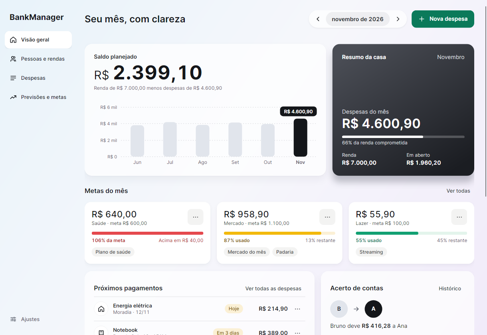
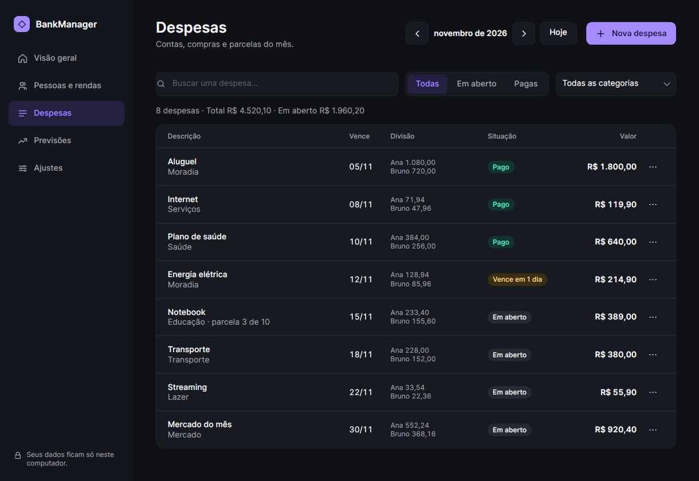

# BankManager

Aplicativo desktop de gestão financeira individual e familiar em **C# / .NET 10 e Avalonia 12.1.4**. Interface em português, com tema claro, escuro ou automático (segue o sistema), menu lateral e armazenamento local. Começa vazio, sem dados fictícios na base do usuário.

**Sobre o desenvolvimento:** este projeto foi desenvolvido com **vibe coding**, usando o Codex para gerar e ajustar o código a partir de instruções em linguagem natural. A proposta, os requisitos e as decisões de produto foram definidos pelo autor do projeto.




## Baixar pronto e compartilhar

**[Baixar a versão mais recente](https://github.com/Muzi3060/BankManager/releases/latest)**

| Computador do seu amigo | Arquivo | Como abrir |
| --- | --- | --- |
| Windows 64 bits (Intel/AMD) | `BankManager-1.0.0-win-x64.zip` | Extrair **tudo** e abrir `BankManager.exe` |
| Linux 64 bits (Intel/AMD) | `BankManager-1.0.0-linux-x64.tar.gz` | Extrair **tudo** e executar `./Iniciar.sh` na pasta |

Os pacotes já incluem o .NET. Seu amigo não precisa instalar SDK, Rider ou Visual Studio. Envie o **link da release** ou o **arquivo compactado completo** por um serviço de arquivos/pendrive. Não envie só o executável, nem seus backups financeiros. Veja [as instruções incluídas no pacote](docs/LEIA-ME.txt).

São versões portáteis, sem instalador e sem assinatura digital. O Windows pode avisar que o editor não foi identificado. No Linux, é necessário desktop com X11/XWayland e bibliotecas do sistema; não há suporte nesses pacotes a ARM ou Alpine/musl. A interface é testada no Linux; o uso visual no Windows ainda exige validação manual.

Para atualizar, exporte um backup e feche o aplicativo antes de extrair a nova versão em outra pasta. Seus dados ficam na pasta local da conta do sistema, separados dos executáveis.

## Executar a partir do código

Requer SDK .NET 10 e ambiente gráfico. No Rider, abra `BankManager.sln`, selecione o projeto **BankManager** e execute. Configure o SDK .NET 10 caso a IDE esteja usando uma instalação antiga.

```bash
dotnet run --project BankManager
```

Se o `dotnet` do seu PATH for de uma versão antiga e o SDK 10 estiver instalado em `~/.dotnet`, o iniciador `run.sh` seleciona essa instalação automaticamente:

```bash
./run.sh
```

A restauração inicial requer NuGet ou pacotes já presentes no cache. O uso do aplicativo é offline. No Linux, é necessário X11/XWayland e as bibliotecas nativas do Avalonia. Windows e macOS usam os respectivos backends do Avalonia; a execução foi validada somente no Linux.

## Como usar

1. Em **Pessoas e rendas**, cadastre as pessoas e a renda líquida do mês selecionado. Zero é válido. Você pode copiar as rendas do mês anterior sem substituir valores já informados.
2. Em **Despesas**, adicione descrição, categoria, vencimento, valor e responsáveis. Para uma compra detalhada, expanda **Lista de itens da compra**, preencha quantidade e preço e clique em **Adicionar item** para cada produto.
3. Escolha divisão **individual**, **igual** ou **proporcional**. Use **Conferir divisão antes de salvar** para ver o resultado.
4. Para dívidas parceladas, informe o **valor total**, incluindo juros já negociados, e até 120 parcelas. Cada vencimento é criado no mês correspondente. Listas de itens são lançadas à vista.
5. Para contas fixas (aluguel, internet, assinaturas), marque **Repetir todo mês** ao criar a despesa. Em **Despesas → Recorrentes** você encerra ou remove cada uma. Na lista de despesas, use o menu **⋯** de cada linha para marcar como paga, editar ou excluir; filtre por busca, situação e categoria e navegue entre meses. **Ctrl+N** abre uma nova despesa em qualquer tela.
6. Em **Previsões**, consulte a estimativa do mês seguinte ao selecionado.
7. Em **Ajustes**, escolha o tema (claro, escuro ou automático) e exporte backups para outro local. Importações são validadas e pedem confirmação antes de substituir o histórico.

## Regras financeiras

- Dinheiro usa `decimal`, com duas casas decimais. A entrada aceita `1500,50`, sem separadores de milhares. Quantidades aceitam até três casas decimais. Cada item é arredondado para centavos antes da soma.
- Renda fica vinculada à pessoa e ao mês; não é propagada automaticamente. Renda ausente é considerada zero e sinalizada na visão geral.
- **Disponível para rateio = máximo(0, renda − despesas individuais do mês)**. Despesas individuais pagas também são descontadas. Cada conta proporcional usa essa mesma base entre seus participantes; despesas iguais não são descontadas da base.
- Exemplo: disponíveis de R$ 3.000 e R$ 1.000 dividem R$ 800 em R$ 600 e R$ 200. Se todas as disponibilidades forem zero, aplica-se divisão igual com aviso. O cálculo não limita a responsabilidade à renda: saldo negativo é mostrado como alerta.
- Os centavos restantes do rateio seguem os maiores restos fracionários, com desempate estável por identificador. A soma sempre coincide com a despesa.
- Parcelas distribuem exatamente o total, incluindo centavos, preservando o dia de referência quando possível: 31/jan → 28 ou 29/fev → 31/mar.
- Editar uma renda ou despesa individual recalcula o rateio daquele mês. O histórico não é um livro contábil imutável. Uma edição/exclusão de parcela afeta apenas o lançamento selecionado.
- **Saldo planejado = renda − todas as despesas do mês**, pagas ou em aberto. Marcar pago quita o lançamento inteiro para todos os responsáveis; não há pagamento parcial ou conciliação bancária.

## Despesas recorrentes

Marcar **Repetir todo mês** guarda um modelo (descrição, categoria, valor, dia, divisão e responsáveis) e cria uma despesa comum para cada mês, do vencimento informado até 12 meses à frente. Ao abrir o aplicativo, a janela avança e os meses novos são criados; nada é duplicado.

- Dia 31 vence no último dia de meses curtos (28 ou 29 em fevereiro).
- Cada mês é independente: pode ser pago, editado (só aquele mês) ou excluído. Um mês excluído não é recriado.
- **Encerrar** define o mês selecionado como última cobrança e remove os meses em aberto depois dele; meses já pagos permanecem. **Remover** (só para recorrências encerradas) tira o modelo da lista e mantém os lançamentos como despesas comuns.
- Recorrentes não usam parcelas nem lista de itens. Editar o valor de um mês não altera os outros: para mudar o valor dali em diante, encerre e crie uma nova.

## Previsões

A média usa até três meses anteriores ao mês previsto, desde o primeiro mês registrado com despesa não parcelada. Meses sem lançamentos dentro dessa janela contam como zero; por isso, histórico incompleto pode subestimar gastos. Um único mês com R$ 1.000 em mercado prevê R$ 1.000 no seguinte. Meses posteriores ao alvo nunca entram no cálculo.

Para cada categoria:

```text
estimativa = máximo(média histórica à vista, despesas à vista já lançadas no alvo)
             + parcelas com vencimento no alvo
```

Parcelas ficam fora da média para não continuarem sendo previstas após o término da dívida. A tela mostra média, meses de base e compromissos conhecidos. A estimativa não modela inflação, sazonalidade ou juros e não garante gastos futuros. No mês atual ainda em andamento, a previsão reflete apenas os registros disponíveis.

## Persistência e proteção

Os arquivos ficam em `Environment.SpecialFolder.LocalApplicationData/BankManager` (o caminho efetivo aparece na interface). Para desenvolvimento/testes, `BANKMANAGER_DATA_DIR` permite escolher uma pasta isolada.

- `financas.json`: base atual, JSON versionado (esquema 2, que acrescentou as despesas recorrentes). Arquivos e backups da versão 1 continuam sendo lidos e são atualizados sem perda; o arquivo antigo vira a cópia anterior no primeiro salvamento. Um arquivo de versão mais nova que a do aplicativo é recusado.
- `settings.json`: preferências do aplicativo (tema). Fica separado das finanças: trocar a aparência nunca altera o `financas.json`, e um arquivo de preferências inválido apenas volta ao padrão.
- `financas.backup.json`: versão anterior ao último salvamento, não um histórico ilimitado de backups.
- `.lock`: bloqueio de acesso concorrente por outra instância cooperante do aplicativo.
- Gravação em arquivo temporário no mesmo diretório, flush e substituição atômica. A interface só adota as alterações após a gravação.
- Validação de importações e salvamentos: referências, identificadores, nomes duplicados, datas, categorias, participantes, totais, precisão, quantidade e parcelamento.
- Limite de 20 MB, profundidade JSON 32, 200 pessoas, 100.000 rendas/despesas e 500 itens por lista. Campos desconhecidos/versões não suportadas são rejeitados. O aplicativo foi pensado para uso doméstico; grandes volumes podem exigir paginação e migração para banco de dados.
- Arquivos inválidos não são substituídos automaticamente; a tela oferece recuperação ou importação.
- No Unix, pasta privada (`0700`) e dados novos privados (`0600`). No Windows, aplicam-se as permissões da pasta do usuário.
- Não há sincronização, envio de dados, execução de scripts nem carregamento de conteúdo remoto a partir dos arquivos importados.

**Os dados não são criptografados**. Backups contêm informações legíveis e precisam ser guardados com cuidado. Proteção contra alguém com acesso à conta do sistema requer segurança do próprio dispositivo. Testes e validações reduzem riscos, mas não constituem garantia de ausência de todas as falhas ou auditoria independente. Não há instaladores assinados. O pipeline compila e executa testes do domínio em Windows e Linux; os testes da interface são executados no Linux. macOS não tem pacote de distribuição nesta entrega.

## Entender o código

Consulte o [guia de leitura do código](docs/GUIA-DO-CODIGO.md) para acompanhar a arquitetura, o caminho de uma edição, os modelos, os cálculos e a persistência. O código contém comentários em português, resumos XML nos tipos e métodos C# e explicações dos cenários de teste e da publicação.

## Estrutura e testes

- `BankManager`: interface Avalonia. Cores (claro e escuro), ícones e estilos em `Styles/*.axaml`; uma página por arquivo em `Pages/`; `MainWindow.cs` guarda o estado e a navegação.
- `BankManager.Core`: modelos, validações, cálculos e armazenamento, sem dependência da interface.
- `BankManager.Tests`: executável de testes do domínio e persistência, sem frameworks adicionais.
- `BankManager.UiTests`: teste de integração com janela real, dados temporários e encerramento automático. Requer display gráfico; não usa a base pessoal.

```bash
dotnet build BankManager.sln -m:1 --disable-build-servers
dotnet run --project BankManager.Tests
dotnet run --project BankManager.UiTests
```

Os executáveis de teste retornam código diferente de zero se falharem. `dotnet test` não executa essas verificações. O domínio cobre rateio, 1.000 combinações de valores, falta de renda, histórico mensal, parcelas, previsões, validação e arquivos. A interface cobre cadastro, prévia, gravação, pagamento, edição inválida e lista de itens. Seletores nativos de arquivos e leitores de tela ainda precisam de testes manuais.

Para gerar capturas de todas as telas, nos temas claro e escuro, com dados de demonstração (fictícios):

```bash
mkdir -p /tmp/capturas && BANKMANAGER_SCREENSHOTS=/tmp/capturas dotnet run --project BankManager.UiTests
```

## Referências de projeto

- [Avalonia: primeiros passos](https://docs.avaloniaui.net/docs/get-started/): estrutura e interface desktop multiplataforma.
- [Actual Budget: começando um orçamento](https://actualbudget.org/docs/getting-started/starting-fresh/): organização por categorias, receitas reais e acompanhamento mensal.
- [Actual Budget: orçamento de acompanhamento](https://actualbudget.org/docs/getting-started/tracking-budget/): visão de receitas, despesas e comparação entre planejamento e resultado.

A implementação de rateio e previsão é própria, com as regras descritas acima; não reproduz o motor contábil desses produtos.

## Gerar novos pacotes

Requer SDK .NET 10, Python 3.11+ e acesso ao NuGet para obter os runtimes:

```bash
python3 scripts/package.py
# Ou apenas um destino:
python3 scripts/package.py --runtime linux-x64
python3 scripts/package.py --runtime win-x64
```

No Windows, use `python` no lugar de `python3`. O script escolhe o SDK em `~/.dotnet` quando disponível; `BANKMANAGER_DOTNET` permite indicar outro executável. Os arquivos finais ficam em `artifacts/releases/`, com checksums SHA-256, e as pastas publicadas em `artifacts/publish/`. São publicações **self-contained**, sem trimming, para preservar a serialização e os componentes dinâmicos da interface.

Para conferir o download no Linux, no diretório dos arquivos:

```bash
sha256sum -c BankManager-1.0.0-linux-x64.tar.gz.sha256
```

No PowerShell, execute `Get-FileHash .\BankManager-1.0.0-win-x64.zip -Algorithm SHA256` e compare o resultado com o conteúdo do arquivo `.sha256`.

O workflow [Build and release](.github/workflows/release.yml) compila, testa e empacota nos runners nativos de Windows e Linux. Em pushes na `main`, os arquivos ficam nos artifacts da execução. Para uma nova release:

1. Atualize `Version` em `BankManager/BankManager.csproj`, as instruções com nomes de arquivos e `docs/RELEASE-NOTES.md`.
2. Faça commit e push dessas mudanças.
3. Crie e envie uma tag correspondente, por exemplo `git tag v1.0.1` e `git push origin v1.0.1`.
4. O workflow publica os pacotes na página Releases somente após todos os jobs passarem.

Referências: [publicação desktop do Avalonia no Linux](https://docs.avaloniaui.net/docs/deployment/linux) e [modelos de distribuição do .NET](https://learn.microsoft.com/en-us/dotnet/core/deploying/).
