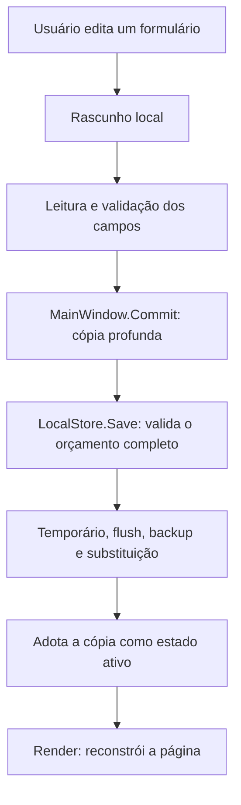

# Guia de leitura do código

Este guia liga os arquivos aos comportamentos do aplicativo. Os comentários em português no código explicam contratos e decisões; os nomes dos tipos e métodos permanecem em inglês para manter a nomenclatura existente.

## Como o projeto está organizado

O código fica em `codigo/` e os testes em `testes/`. O aplicativo (`codigo/BankManager/`) tem `Paginas/` (uma página por arquivo), `Dialogos/` (diálogos e painéis reaproveitados), `Controles/` (o gráfico), `Estilos/` (cores, ícones e estilos em XAML) e `Recursos/` (o ícone). O núcleo (`codigo/BankManager.Nucleo/`) tem `Modelos/`, `Regras/`, `Motores/` (os cálculos) e `Arquivos/` (gravação, migração, CSV e compartilhamento).

Os nomes do projeto estão em português. A exceção são os nomes gravados nos arquivos de dados, que continuam em inglês por compatibilidade: em `Modelos/Modelos.cs`, cada propriedade gravada tem `[JsonPropertyName("NomeAntigo")]`. Ao criar uma propriedade nova que vá para o arquivo, dê a ela esse atributo também. O `docs/GLOSSARIO.md` traz a correspondência entre os nomes antigos e os novos.

## Por onde começar

1. `codigo/BankManager/Programa.cs`: entrada do processo e configuração do Avalonia.
2. `codigo/BankManager/Aplicativo.axaml.cs`: carrega recursos e cria a janela principal.
3. `codigo/BankManager.Nucleo/Modelos/Modelos.cs`: vocabulário do domínio: pessoas, renda mensal, despesas, itens e tipos de divisão.
4. `codigo/BankManager.Nucleo/Regras/RegrasDoOrcamento.cs`: o que um orçamento válido pode conter.
5. `codigo/BankManager.Nucleo/Motores/MotorFinanceiro.cs`: consulta mensal, divisão, saldos, estimativa, totais por mês (gráfico) e últimas movimentações.
6. `codigo/BankManager.Nucleo/Arquivos/ArmazenamentoLocal.cs`: leitura, validação de arquivos, gravação, backup e bloqueio de outra instância.
7. `codigo/BankManager/JanelaPrincipal.cs`: estado ativo, navegação, gravação (`Gravar`) e tratamento de erros. Cada página é uma parte da mesma classe (`partial class`), em `codigo/BankManager/Paginas/`: `PaginaVisaoGeral.cs`, `PaginaPessoas.cs`, `PaginaDespesas.cs`, `PaginaPrevisoes.cs` (Previsões e metas, com o submenu) e `PaginaAjustes.cs`; os blocos reaproveitados ficam em `PaineisDeMetas.cs`, `PaineisDeAcerto.cs`, `DialogoRecorrencias.cs` e `DialogosCsv.cs`.
8. `codigo/BankManager/Componentes.cs`: fábricas de controles (`Texto`, `Botao`, `Icone`, `Cartao`, `Dialogo`…).
9. `codigo/BankManager/Estilos/`: `Cores.axaml` (todas as cores, para os temas claro e escuro), `Icones.axaml` (ícones vetoriais) e `Controles.axaml` (estilos dos controles). `Aplicativo.axaml` apenas reúne esses arquivos. `codigo/BankManager/Controles/GraficoDeBarras.cs` é o gráfico de barras, desenhado pelo próprio controle.
10. `codigo/BankManager.Nucleo/Modelos/Preferencias.cs`: preferências do aplicativo (tema) em `settings.json`.
11. `codigo/BankManager.Nucleo/Motores/MotorDeRecorrencias.cs` e `Arquivos/MigracoesDeDados.cs`: despesas mensais e atualização de arquivos antigos.
12. `codigo/BankManager.Nucleo/Motores/MotorDeAcertos.cs`: quem deve a quem (acerto de contas).
13. `codigo/BankManager.Nucleo/Motores/MotorDeCategorias.cs`: categorias próprias (criar, renomear, excluir).
14. `codigo/BankManager.Nucleo/Motores/MotorDeMetas.cs`: metas mensais por categoria e seu progresso.
15. `codigo/BankManager.Nucleo/Regras/BuscaDeDespesas.cs`: busca e filtros da lista (um mês ou todos).
16. `codigo/BankManager.Nucleo/Arquivos/Csv.cs`, `Arquivos/ExportacaoCsv.cs` e `Arquivos/ImportacaoDeExtrato.cs`: leitura/escrita de CSV, exportação e importação de extratos.
17. `codigo/BankManager.Nucleo/Arquivos/CompartilhamentoDeDespesas.cs`: arquivo de compartilhamento de despesas (exportar as escolhidas, importar adicionando); o modo de seleção fica em `Paginas/PaginaDespesas.cs`, o diálogo de exportar em `Dialogos/ExportarCompartilhamento.cs`, o assistente de importação em `Dialogos/ImportarCompartilhamento.cs` e a base dos diálogos sobrepostos em `codigo/BankManager/Dialogos/Sobreposicao.cs`.
18. `codigo/BankManager.Nucleo/Regras/SituacaoDoPrazo.cs`: situação de vencimento (Pago, Em aberto, Vence em breve, Em atraso), base dos chips da interface.

Os métodos e tipos C# possuem resumos XML (`///`), exibidos pelo Rider ao inspecionar um símbolo. Comentários `//` dentro dos métodos explicam etapas e decisões locais.

## Como os projetos se relacionam

| Projeto/arquivo | Responsabilidade | Dependências principais |
| --- | --- | --- |
| `BankManager.Nucleo` | Regras financeiras e armazenamento local | Biblioteca padrão do .NET |
| `BankManager` | Janela, páginas, formulários e mensagens | Core e Avalonia |
| `BankManager.Testes` | Testes de domínio e arquivos | Core |
| `BankManager.TestesDeInterface` | Roteiro de integração com janela real | App, Core e Avalonia |
| `scripts/empacotar.py` | Publicação, compactação, licenças e checksums | Python e SDK .NET |
| `.github/workflows/release.yml` | Builds e testes nos dois sistemas, publicação de tags | GitHub Actions |

As telas são compostas em C# com as fábricas de `Componentes`; o XAML concentra cores, ícones e estilos. Nesta versão, `JanelaPrincipal` coordena estado, eventos e navegação, sem uma camada separada de ViewModels (veja “Por que não MVVM” abaixo). Já as regras de cálculo podem ser usadas e testadas sem abrir uma janela.

## Caminho de uma edição



`Gravar` é o caminho comum de alteração. O callback recebido altera uma cópia de `DadosDoOrcamento`; só depois de `Salvar` concluir essa cópia passa a ser o estado ativo. Se a validação ou a gravação falhar antes dessa atribuição, o orçamento ativo não é trocado.

`Importar` e `Recuperar` salvam diretamente antes de atribuir o estado, pois também precisam funcionar quando a base original não pôde ser carregada. Importar requer primeiro um armazenamento aberto; uma instância que não conseguiu adquirir o bloqueio não pode substituir a base de outra.

Cancelar um formulário descarta seu rascunho. A prévia de divisão também usa uma cópia que contém a despesa candidata, pois uma alteração de despesa individual afeta os pesos do mês. A prévia não grava dados e não substitui a validação ao salvar.

## Modelos e referências

`DadosDoOrcamento` é a raiz serializada em JSON e guarda todo o histórico. `Versao` identifica o formato, não a versão comercial do aplicativo.

- `Pessoa.Id` é a chave estável de uma pessoa; mudar seu nome preserva as referências.
- `RendaMensal` é uma linha de renda (`Rotulo` e `Valor`) de uma pessoa em um mês (primeiro dia), com `Id` próprio. A renda do mês é a soma das linhas (`MotorFinanceiro.Renda`). Ausência de linhas equivale a zero no cálculo, mas a tela sinaliza que a renda não foi preenchida.
- `Despesa.Participantes` referencia pessoas por identificador. O modo individual exige um único participante.
- `Despesa.Itens` detalha uma compra à vista; a soma dos itens determina o valor.
- `Despesa.PagaPor` guarda quem pagou (só em despesas pagas; nulo é "não informado"). `Acerto` é um pagamento entre duas pessoas que abate uma dívida; não é uma despesa.
- `Recorrencia` é o modelo de uma despesa mensal. Os lançamentos que ela gera são `Despesa` comuns, ligados por `IdDaRecorrencia` e `MesDaRecorrencia` (o mês de origem, que não muda mesmo que o vencimento seja editado).
- `GrupoDeParcelas` relaciona parcelas criadas juntas, mas cada `Despesa` tem seu próprio `Id`, vencimento, valor e situação de pagamento.

Os modelos são `record`, mas suas propriedades e listas são mutáveis. Uma expressão `with` faz uma cópia superficial; não garante isolamento das listas. `ArmazenamentoLocal.Clonar` faz a cópia profunda pelo formato JSON para isolar o estado ativo durante a edição. Na criação de parcelas, as coleções são copiadas explicitamente.

`Datas.Mes` transforma qualquer data no primeiro dia do mês. As rendas já devem estar normalizadas; despesas mantêm o dia de vencimento para exibição e ordenação.

## Como ler os cálculos

### Dinheiro, itens e parcelas

`Dinheiro.Interpretar` aceita valores como `1500,50`, sem ponto de milhar ou símbolo de moeda. `Dinheiro.Formatar` faz a apresentação em reais; seu resultado não é uma entrada válida para `Interpretar`. A entrada e os arquivos são validados separadamente.

Dinheiro usa `decimal`. `ItemDaDespesa.Total` arredonda quantidade × preço para centavos, afastando empates de zero; a compra soma esses totais já arredondados. Uma dívida parcelada recebe o valor total já com os juros negociados; o motor não calcula taxas bancárias.

`RegrasDoOrcamento.Parcelar` converte o total em centavos inteiros. O quociente define a parcela básica e o resto acrescenta um centavo às primeiras parcelas. Exemplo: R$ 100 em três parcelas produz R$ 33,34, R$ 33,33 e R$ 33,33. As datas partem sempre do vencimento original, evitando que o ajuste de fevereiro altere o dia de março.

### Recorrências e versões do esquema

`MotorDeRecorrencias.Gerar` é idempotente: para cada modelo, cria só os meses que faltam entre o mês inicial e o horizonte (12 meses à frente), pulando os que o usuário excluiu (`MesesPulados`). Por isso a interface sempre exclui lançamentos com `RemoverDespesa`, que registra o mês ignorado. `Encerrar` e `Remover` mantêm o histórico pago. A data de referência entra por parâmetro, o que torna tudo testável.

`DadosDoOrcamento.Versao` é a versão do esquema (hoje 3: a 2 trouxe recorrências, quem pagou, metas e categorias; a 3, `Despesa.DataDoPagamento` e `Despesa.IdDeOrigem`). A migração é em cadeia (1 → 2 → 3) e os testes a exercitam com arquivos reais das versões 1 e 2, guardados em `testes/BankManager.Testes/ArquivosDeTeste/`. `MigracoesDeDados.ParaVersaoAtual` leva dados antigos à versão atual em memória, passo a passo, e `ArmazenamentoLocal.Ler` o chama antes de validar; assim importações, recuperação e a base normal se beneficiam. Para criar a versão 3, acrescente um passo ali, suba `VersaoAtual` e escreva o teste "arquivo v2 migra para v3". Regra do projeto: a Fase 3 inteira usa o esquema 2, e novos campos desta fase entram nele com valores padrão que equivalem a "não usado".

### Acerto de contas

`MotorDeAcertos.Dividas` percorre as despesas pagas com `PagaPor` e acumula, para cada par (devedor, credor), a parte de cada participante obtida de `MotorFinanceiro.Ratear`. Depois subtrai os `Acerto` e compensa o sentido contrário de cada par. O resultado é uma lista de `Divida` e não é gravado: sempre recalculado a partir das despesas e dos acertos. Não há simplificação entre três ou mais pessoas, de propósito: "Bruno deve a Ana" só aparece se Ana pagou algo por Bruno.

### Rateio

`MotorFinanceiro.Ratear` começa com pesos iguais. No modo proporcional, cada peso passa a ser:

```text
máximo(0, renda do mês − todas as despesas individuais do mês)
```

Despesas individuais pagas também consomem a capacidade daquele mês. Despesas compartilhadas não são subtraídas dessa base; assim o cálculo não depende da ordem em que as contas são divididas. Somente os responsáveis selecionados participam do denominador. Todos os pesos zerados acionam divisão igual com um aviso.

As cotas exatas em centavos são arredondadas para baixo. Os centavos restantes são atribuídos às maiores partes fracionárias; o identificador desempata de forma estável. A soma final é a despesa original, sem atribuir peso negativo.

`Saldos` soma as cotas e separa as despesas quitadas. `Sobra` é renda menos toda a responsabilidade do mês: é saldo planejado, não leitura de uma conta bancária.

### Previsão

`Previsoes` recebe o mês alvo, que a tela define como o seguinte ao selecionado. A janela usa até três meses anteriores ao alvo, começando no primeiro mês registrado com despesa não parcelada. Meses vazios dentro dessa janela contam como zero. Um mês anterior ainda em andamento pode ter dados parciais.

A média exclui parcelamentos; estes contribuem apenas com parcelas que vencem no alvo. Por categoria, a estimativa usa o maior valor entre média e compromissos à vista já lançados, somado às parcelas do alvo. Isso evita somar novamente uma compra à vista que já está representada pela média. O resultado é uma estimativa baseada nos registros, não um modelo de inflação ou sazonalidade.

## Interface e tratamento de erros

`JanelaPrincipal` mantém a competência atual, o índice de página, os filtros e o estado carregado. `Desenhar` reconstrói a página escolhida após mudanças. `PaginaDeDespesas.Atualizar` atualiza apenas os resultados dos filtros, sem recriar o campo em que o usuário está digitando.

`ready` diferencia uma base vazia válida de uma falha de abertura. Com falha, a tela oferece nova tentativa, importação ou recuperação em vez de liberar edições sobre dados desconhecidos.

`Executar` captura erros das ações assíncronas e chama `MostrarErro`. Editores mantêm suas próprias mensagens com `ErroAmigavel`, para que o usuário possa corrigir o campo sem fechar o formulário. `ErroDeOrcamento` é um erro esperado de negócio com mensagem apresentável; erros técnicos recebem mensagens genéricas.

Em `Componentes.Campo`, o rótulo e a ajuda também são registrados nas propriedades de acessibilidade. As classes aplicadas aos controles, como `primary`, `card` e `muted`, são definidas em `Aplicativo.axaml`.

### Temas, cores e ícones

Nenhuma cor aparece no código C#. `Estilos/Cores.axaml` define cada cor com nome (por exemplo `CorDaSuperficie`, `CorPrimaria`) duas vezes, uma para `Claro` e outra para `Escuro`, em `ThemeDictionaries`. Os estilos de `Controles.axaml` e o C# só citam esses nomes (`DynamicResource` ou classes como `muted`, `positive`, `negative`), então trocar de tema atualiza tudo ao vivo. Para mudar uma cor, edite apenas o `Cores.axaml`.

O visual é o "Estilo C": o fundo da janela é um degradê (`CorDoFundo`, um `LinearGradientBrush`), os cartões comuns são translúcidos (`CorDaSuperficie`, branco com opacidade; não há desfoque real nem acrílico, que variam por sistema), os cartões de meta são sólidos (`CorDaSuperficieSolida`) e o "Resumo da casa" é um cartão escuro em degradê (`CorDoResumo`). As sombras também são tokens (`SombraDoCartao`, `SombraDoCartaoSolido`, `SombraDoResumo`, `SombraDoMenu`), aplicadas com `BoxShadow`. Cada estado tem três cores: a do texto (`CorPositiva`, `CorDeAlerta`, `CorNegativa`), a do fundo suave (`...SoftBrush`, usada em chips e trilhos) e a da barra (`CorDoProgressoBom`, `CorDoProgressoAlerta`, `CorDoProgressoAcima`). O estilo da janela liga os algarismos tabulares (`FontFeatures="+tnum"`) para o aplicativo inteiro.

A preferência (Automático, Claro ou Escuro) fica em `settings.json`, lida por `ArmazenamentoDePreferencias` antes de a janela aparecer. `Aplicativo.AplicarTema` ajusta `RequestedThemeVariant`; no modo Automático ele volta ao padrão, que acompanha o sistema.

Os ícones são traços vetoriais 24×24 em `Icones.axaml`; `Componentes.Icone("Home")` os desenha com a cor do botão que os contém, igual em Windows e Linux. O ícone do aplicativo vem de `Recursos/icone.svg`; `scripts/gerar-icones.sh` gera o `icone.png` (janela) e o `icone.ico` (executável do Windows).

### Compartilhar despesas

`CompartilhamentoDeDespesas` (Core) cuida de tudo sem tocar na interface. `Montar` monta um `ArquivoDeCompartilhamento` com as despesas escolhidas; as pessoas vão pelo nome, porque os Ids de quem envia não existem na base de quem recebe. `Ler` e `Validar` aplicam as proteções do backup (tamanho, profundidade, campos desconhecidos, versão) e conferem o campo `Tipo`, que distingue o compartilhamento do backup; `ArmazenamentoLocal.Ler` faz a conferência inversa. `Sugerir` propõe o mapeamento de pessoas e categorias, e `Importar` calcula o resultado em uma cópia profunda e valida o orçamento inteiro: serve de prévia e não altera nada. Para gravar, a tela chama `Gravar(d => CompartilhamentoDeDespesas.Aplicar(d, ...))`, o mesmo caminho seguro de qualquer edição (cópia, validação, gravação atômica, cópia anterior). Cada despesa importada guarda em `IdDeOrigem` o Id que tinha na origem; é por ele que uma segunda importação reconhece as duplicadas.

Na interface, o fluxo tem três partes. O **modo de seleção** (`selecionando` e `idsSelecionados`, na janela) faz a lista de despesas desenhar caixas de marcação e mostra uma barra flutuante que fica fora da área rolável. O **diálogo de exportar** e o **assistente de importação** não são janelas do sistema: são cartões desenhados sobre a própria janela, por `MostrarSobreposicao` (`Dialogos/Sobreposicao.cs`). A camada escura bloqueia cliques no que está atrás, o Tab circula só dentro do cartão, o foco vai para o título ao abrir e volta ao botão de origem ao fechar, e a tecla Esc é entregue ao diálogo. O assistente guarda as escolhas em variáveis locais de `ImportarCompartilhadas` e redesenha cada passo a partir delas; por isso voltar um passo não perde nada. `CompartilhamentoDeDespesas.Importar` devolve uma `LinhaDaImportacao` por despesa do arquivo (adicionar, pular ou erro), e é isso que a prévia mostra. Os testes de interface usam `CaminhoDeTesteParaSalvar` e `CaminhoDeTesteParaAbrir` no lugar do seletor de arquivos do sistema.

### Componentes de interface

`Componentes.cs` reúne as peças reaproveitadas pelas páginas: `Etiqueta` (etiqueta de situação), `Avatar` (inicial da pessoa), `Segmentado` (opções lado a lado), `Recolhivel` (seção de ajuda que abre e fecha), `Divisoria`, `CirculoComIcone` (círculo com o ícone da categoria, escolhido por `NomeDoIconeDaCategoria`), `Cartao` (estilos `card`, `solid` e `summary`) e `Botao` (com ícone, ou só ícone; variantes `primary`, `ink`, `ghost`, `link`). Cada página monta o próprio cabeçalho com `CabecalhoDaPagina` (título, navegação de mês em pílula e "Nova despesa").

O gráfico da visão geral é o controle `GraficoDeBarras` (`Controles/GraficoDeBarras.cs`): ele recebe os pontos prontos e desenha tudo em `Desenhar` com `DrawingContext` (linhas pontilhadas, barras, rótulos e balão), sem biblioteca externa. `GraficoDeBarras.Eixo` escolhe o topo e o passo do eixo, que sempre começa em zero. As cores chegam por propriedades preenchidas no estilo de `Controles.axaml`, então o gráfico acompanha o tema. Os dados vêm de `MotorFinanceiro.TotaisMensais` e a lista "Últimas movimentações" de `MotorFinanceiro.MovimentacoesRecentes`, ambos no Core e com testes. A decisão de "quantos dias faltam" não está na interface: `SituacaoDoPrazo.De` (Core, com testes) a calcula e a tela só escolhe o texto e a cor do chip.

### Por que não MVVM (por enquanto)

Migrar para ViewModels exigiria reescrever todas as telas, sem ganho visível. As regras já estão isoladas no Core e testáveis sem janela, que é o benefício principal. MVVM passa a compensar se as telas crescerem muito ou se for preciso testar a lógica de apresentação sem abrir janelas; a divisão em `Paginas/` já prepara esse passo.

## Persistência e seus limites

`ArmazenamentoLocal` abre `.lock` sem compartilhamento e mantém o handle até `Dispose`, ligado ao fechamento da janela. Isso impede outro acesso cooperante pelo aplicativo; não protege contra programas externos que ignorem esse mecanismo.

A leitura limita o tamanho, rejeita JSON incompatível e chama `RegrasDoOrcamento.Validar`. Só a inexistência da base cria um orçamento vazio. Uma base existente inválida produz um erro de abertura.

Na gravação, o arquivo temporário fica no mesmo diretório. O código descarrega o buffer de texto, solicita flush em disco, copia a versão atual para o backup e renomeia o temporário sobre o destino. Não há histórico ilimitado: o backup é a versão anterior ao último salvamento. Exceções são propagadas, e o temporário é removido ao sair quando possível. Esse procedimento não equivale a uma garantia contra toda falha de hardware ou sistema de arquivos.

O JSON é legível, sem criptografia. No Unix, a pasta e os arquivos novos recebem permissões privadas; no Windows, dependem das permissões da conta. `RecusarCaminhoInterno` evita que os seletores usem arquivos diretamente na pasta interna para exportar/importar, protegendo também o bloqueio.

## Testes e publicação

### GIFs de demonstração

`scripts/gerar-midia.py` refaz os GIFs de `docs/midia/` com um comando. Ele funciona em duas partes. Primeiro, o executável de testes de interface roda em modo de mídia (`BANKMANAGER_MIDIA=<pasta>` e `BANKMANAGER_MIDIA_CENA=<cena>`): em vez de verificar o aplicativo, ele segue um roteiro curto com dados fictícios, salva um PNG por passo e escreve em `roteiro.tsv` a legenda, o tempo de exibição e a área do controle clicado. As cenas ficam no bloco "Modo de mídia" de `testes/BankManager.TestesDeInterface/TestesDeInterface.cs`; para mudar um GIF, edite o roteiro da cena. Depois, o script Python monta cada GIF com o Pillow: desenha o contorno verde no controle (os quadros não têm cursor), reduz para 900 px, escreve a legenda, cria dois quadros de transição entre os passos e grava com uma paleta única. A pasta de dados é sempre temporária, criada pelo próprio teste.

`testes/BankManager.Testes/Programa.cs` registra cada cenário com `Teste`, executa todos e retorna falha se algum não passar. Há comentários em português para cada caso. `Familia` e `Conta` criam dados sintéticos; testes de arquivos usam temporários. A bateria de rateio usa semente fixa para tornar as amostras reproduzíveis.

`testes/BankManager.TestesDeInterface/Programa.cs` configura a pasta temporária antes de criar o aplicativo, espera a inicialização gráfica e executa o roteiro na thread da interface. Os cliques disparam eventos dos botões, sem coordenadas do mouse. Há verificações na tela e no JSON salvo. Seletores de arquivos nativos e leitores de tela não são cobertos por esse roteiro.

`scripts/instaladores.py` parte da pasta publicada por `empacotar.py` e gera o instalador do Windows (Inno Setup, `instalador/windows/BankManager.iss`) e o AppImage do Linux (`instalador/linux/`: `AppRun`, `.desktop`, metadados). O `appimagetool` é fixado por versão e checksum. `Instalar-atalho.sh`, que acompanha o pacote portátil do Linux, cria o atalho do menu para o usuário. Não há atualizador dentro do aplicativo, por escolha: ele nunca acessa a internet.

`executar.sh` compila e inicia a versão de desenvolvimento. Já `scripts/empacotar.py` publica o aplicativo com o .NET incluído, coleta avisos de terceiros, prepara o iniciador Linux, compacta e calcula SHA-256. A validação de versão ocorre antes de construir nomes de diretório.

O workflow executa os testes de domínio nos dois sistemas e os testes gráficos no Linux via Xvfb (no Windows eles rodam como aviso, com `continue-on-error`, até serem validados lá), gera o instalador e o AppImage e faz um teste de fumaça de cada um. Somente tags com versão correspondente ao projeto podem criar releases, e o job de publicação depende do sucesso de ambos os destinos. `global.json` seleciona a família do SDK; por ser JSON, sua explicação fica neste guia em vez de comentários dentro do arquivo.

Para os comandos de execução, testes e distribuição, consulte o [README](../README.md).
