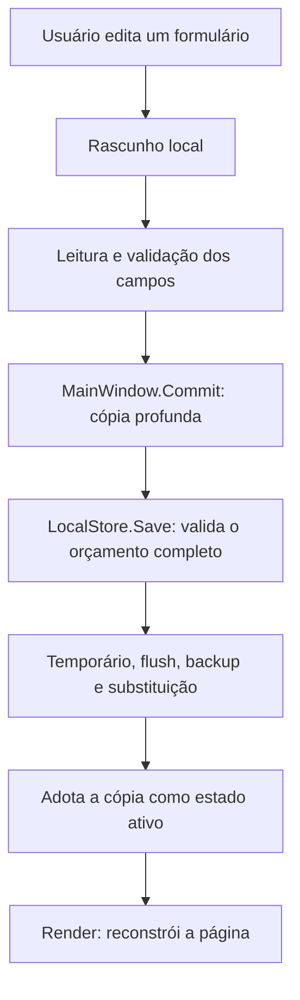

# Guia de leitura do código

Este guia liga os arquivos aos comportamentos do aplicativo. Os comentários em português no código explicam contratos e decisões; os nomes dos tipos e métodos permanecem em inglês para manter a nomenclatura existente.

## Por onde começar

1. `BankManager/Program.cs`: entrada do processo e configuração do Avalonia.
2. `BankManager/App.axaml.cs`: carrega recursos e cria a janela principal.
3. `BankManager.Core/Models.cs`: vocabulário do domínio: pessoas, renda mensal, despesas, itens e tipos de divisão.
4. `BankManager.Core/BudgetRules.cs`: o que um orçamento válido pode conter.
5. `BankManager.Core/FinanceEngine.cs`: consulta mensal, divisão, saldos e estimativa.
6. `BankManager.Core/LocalStore.cs`: leitura, validação de arquivos, gravação, backup e bloqueio de outra instância.
7. `BankManager/MainWindow.cs`: navegação, formulários e ligação entre tela, cálculo e disco.
8. `BankManager/Ui.cs` e `BankManager/App.axaml`: componentes compartilhados e apresentação.

Os métodos e tipos C# possuem resumos XML (`///`), exibidos pelo Rider ao inspecionar um símbolo. Comentários `//` dentro dos métodos explicam etapas e decisões locais.

## Como os projetos se relacionam

| Projeto/arquivo | Responsabilidade | Dependências principais |
| --- | --- | --- |
| `BankManager.Core` | Regras financeiras e armazenamento local | Biblioteca padrão do .NET |
| `BankManager` | Janela, páginas, formulários e mensagens | Core e Avalonia |
| `BankManager.Tests` | Testes de domínio e arquivos | Core |
| `BankManager.UiTests` | Roteiro de integração com janela real | App, Core e Avalonia |
| `scripts/package.py` | Publicação, compactação, licenças e checksums | Python e SDK .NET |
| `.github/workflows/release.yml` | Builds e testes nos dois sistemas, publicação de tags | GitHub Actions |

As telas são compostas em C# com as fábricas de `Ui`; o XAML concentra os estilos globais. Nesta versão, `MainWindow` coordena estado, eventos e navegação, sem uma camada separada de ViewModels. Já as regras de cálculo podem ser usadas e testadas sem abrir uma janela.

## Caminho de uma edição



`Commit` é o caminho comum de alteração. O callback recebido altera uma cópia de `BudgetData`; só depois de `Save` concluir essa cópia passa a ser o estado ativo. Se a validação ou a gravação falhar antes dessa atribuição, o orçamento ativo não é trocado.

`Import` e `Recover` salvam diretamente antes de atribuir o estado, pois também precisam funcionar quando a base original não pôde ser carregada. Importar requer primeiro um armazenamento aberto; uma instância que não conseguiu adquirir o bloqueio não pode substituir a base de outra.

Cancelar um formulário descarta seu rascunho. A prévia de divisão também usa uma cópia que contém a despesa candidata, pois uma alteração de despesa individual afeta os pesos do mês. A prévia não grava dados e não substitui a validação ao salvar.

## Modelos e referências

`BudgetData` é a raiz serializada em JSON e guarda todo o histórico. `Version` identifica o formato, não a versão comercial do aplicativo.

- `Person.Id` é a chave estável de uma pessoa; mudar seu nome preserva as referências.
- `MonthlyIncome` usa a chave composta pessoa + primeiro dia do mês. Ausência de registro equivale a zero no cálculo, mas a tela sinaliza que a renda não foi preenchida.
- `Expense.Participants` referencia pessoas por identificador. O modo individual exige um único participante.
- `Expense.Items` detalha uma compra à vista; a soma dos itens determina o valor.
- `InstallmentGroup` relaciona parcelas criadas juntas, mas cada `Expense` tem seu próprio `Id`, vencimento, valor e situação de pagamento.

Os modelos são `record`, mas suas propriedades e listas são mutáveis. Uma expressão `with` faz uma cópia superficial; não garante isolamento das listas. `LocalStore.Clone` faz a cópia profunda pelo formato JSON para isolar o estado ativo durante a edição. Na criação de parcelas, as coleções são copiadas explicitamente.

`Dates.Month` transforma qualquer data no primeiro dia do mês. As rendas já devem estar normalizadas; despesas mantêm o dia de vencimento para exibição e ordenação.

## Como ler os cálculos

### Dinheiro, itens e parcelas

`Money.Parse` aceita valores como `1500,50`, sem ponto de milhar ou símbolo de moeda. `Money.Format` faz a apresentação em reais; seu resultado não é uma entrada válida para `Parse`. A entrada e os arquivos são validados separadamente.

Dinheiro usa `decimal`. `ExpenseItem.Total` arredonda quantidade × preço para centavos, afastando empates de zero; a compra soma esses totais já arredondados. Uma dívida parcelada recebe o valor total já com os juros negociados; o motor não calcula taxas bancárias.

`BudgetRules.Installments` converte o total em centavos inteiros. O quociente define a parcela básica e o resto acrescenta um centavo às primeiras parcelas. Exemplo: R$ 100 em três parcelas produz R$ 33,34, R$ 33,33 e R$ 33,33. As datas partem sempre do vencimento original, evitando que o ajuste de fevereiro altere o dia de março.

### Rateio

`FinanceEngine.Allocate` começa com pesos iguais. No modo proporcional, cada peso passa a ser:

```text
máximo(0, renda do mês − todas as despesas individuais do mês)
```

Despesas individuais pagas também consomem a capacidade daquele mês. Despesas compartilhadas não são subtraídas dessa base; assim o cálculo não depende da ordem em que as contas são divididas. Somente os responsáveis selecionados participam do denominador. Todos os pesos zerados acionam divisão igual com um aviso.

As cotas exatas em centavos são arredondadas para baixo. Os centavos restantes são atribuídos às maiores partes fracionárias; o identificador desempata de forma estável. A soma final é a despesa original, sem atribuir peso negativo.

`Balances` soma as cotas e separa as despesas quitadas. `Remaining` é renda menos toda a responsabilidade do mês: é saldo planejado, não leitura de uma conta bancária.

### Previsão

`Forecasts` recebe o mês alvo, que a tela define como o seguinte ao selecionado. A janela usa até três meses anteriores ao alvo, começando no primeiro mês registrado com despesa não parcelada. Meses vazios dentro dessa janela contam como zero. Um mês anterior ainda em andamento pode ter dados parciais.

A média exclui parcelamentos; estes contribuem apenas com parcelas que vencem no alvo. Por categoria, a estimativa usa o maior valor entre média e compromissos à vista já lançados, somado às parcelas do alvo. Isso evita somar novamente uma compra à vista que já está representada pela média. O resultado é uma estimativa baseada nos registros, não um modelo de inflação ou sazonalidade.

## Interface e tratamento de erros

`MainWindow` mantém a competência atual, o índice de página, os filtros e o estado carregado. `Render` reconstrói a página escolhida após mudanças. `ExpensesPage.Refresh` atualiza apenas os resultados dos filtros, sem recriar o campo em que o usuário está digitando.

`ready` diferencia uma base vazia válida de uma falha de abertura. Com falha, a tela oferece nova tentativa, importação ou recuperação em vez de liberar edições sobre dados desconhecidos.

`Run` captura erros das ações assíncronas e chama `ShowError`. Editores mantêm suas próprias mensagens com `FriendlyError`, para que o usuário possa corrigir o campo sem fechar o formulário. `BudgetException` é um erro esperado de negócio com mensagem apresentável; erros técnicos recebem mensagens genéricas.

Em `Ui.Field`, o rótulo e a ajuda também são registrados nas propriedades de acessibilidade. As classes aplicadas aos controles, como `primary`, `card` e `muted`, são definidas em `App.axaml`.

## Persistência e seus limites

`LocalStore` abre `.lock` sem compartilhamento e mantém o handle até `Dispose`, ligado ao fechamento da janela. Isso impede outro acesso cooperante pelo aplicativo; não protege contra programas externos que ignorem esse mecanismo.

A leitura limita o tamanho, rejeita JSON incompatível e chama `BudgetRules.Validate`. Só a inexistência da base cria um orçamento vazio. Uma base existente inválida produz um erro de abertura.

Na gravação, o arquivo temporário fica no mesmo diretório. O código descarrega o buffer de texto, solicita flush em disco, copia a versão atual para o backup e renomeia o temporário sobre o destino. Não há histórico ilimitado: o backup é a versão anterior ao último salvamento. Exceções são propagadas, e o temporário é removido ao sair quando possível. Esse procedimento não equivale a uma garantia contra toda falha de hardware ou sistema de arquivos.

O JSON é legível, sem criptografia. No Unix, a pasta e os arquivos novos recebem permissões privadas; no Windows, dependem das permissões da conta. `RejectInternalPath` evita que os seletores usem arquivos diretamente na pasta interna para exportar/importar, protegendo também o bloqueio.

## Testes e publicação

`BankManager.Tests/Program.cs` registra cada cenário com `Test`, executa todos e retorna falha se algum não passar. Há comentários em português para cada caso. `Family` e `Bill` criam dados sintéticos; testes de arquivos usam temporários. A bateria de rateio usa semente fixa para tornar as amostras reproduzíveis.

`BankManager.UiTests/Program.cs` configura a pasta temporária antes de criar o aplicativo, espera a inicialização gráfica e executa o roteiro na thread da interface. Os cliques disparam eventos dos botões, sem coordenadas do mouse. Há verificações na tela e no JSON salvo. Seletores de arquivos nativos e leitores de tela não são cobertos por esse roteiro.

`run.sh` compila e inicia a versão de desenvolvimento. Já `scripts/package.py` publica o aplicativo com o .NET incluído, coleta avisos de terceiros, prepara o iniciador Linux, compacta e calcula SHA-256. A validação de versão ocorre antes de construir nomes de diretório.

O workflow executa os testes de domínio nos dois sistemas e os testes gráficos no Linux via Xvfb. Somente tags com versão correspondente ao projeto podem criar releases, e o job de publicação depende do sucesso de ambos os destinos. `global.json` seleciona a família do SDK; por ser JSON, sua explicação fica neste guia em vez de comentários dentro do arquivo.

Para os comandos de execução, testes e distribuição, consulte o [README](../README.md).
